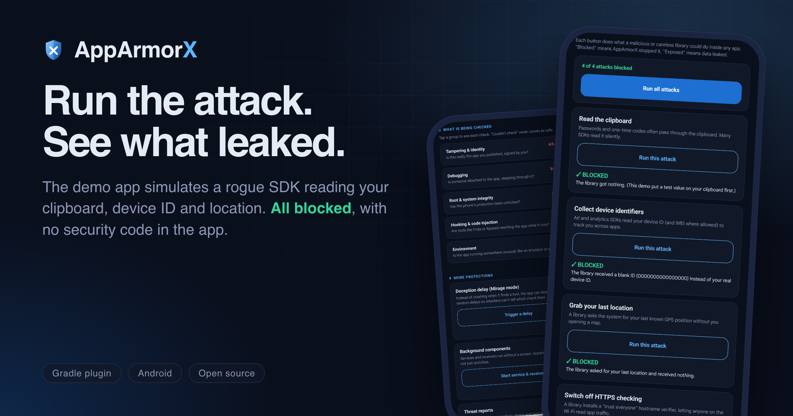

<p align="center">
  
</p>

<h3 align="center">In-app security for Android, delivered as a single Gradle plugin.<br>Free. Inspectable. Zero integration code.</h3>

<p align="center">
  <a href="https://plugins.gradle.org/plugin/com.apparmorx.security"></a>
  <a href="LICENSE"></a>
  <a href=".github/workflows/ci.yml"></a>
  
  
</p>

<p align="center">
  <a href="https://plugins.gradle.org/plugin/com.apparmorx.security">Plugin Portal</a> ·
  <a href="QUICKSTART.md">Quickstart</a> ·
  <a href="docs/USER-GUIDE.md">User guide</a> ·
  <a href="docs/ARCHITECTURE.md">Architecture</a> ·
  <a href="docs/VALIDATION.md">Validation</a> ·
  <a href="docs/HONEST-LIMITS.md">Honest limits</a>
</p>

---

> **0.1.1 patch:** adds supported external dependency JAR/AAR call rewriting and hardens unavailable/malformed evidence handling.
> Version 0.1.0 covered project bytecode only. See [qualification evidence](docs/RELEASE-QUALIFICATION-0.1.1.md).
> AppArmorX remains pre-1.0; supported coverage and recorded limits still apply.

## One plugin. No security code.

```kotlin
plugins {
    id("com.android.application")
    id("com.apparmorx.security") version "0.1.1"
}
```

That is the whole integration. Published on the
[Gradle Plugin Portal](https://plugins.gradle.org/plugin/com.apparmorx.security) as `com.apparmorx.security`. At build time AppArmorX rewrites your app's bytecode, bundles a native
detection engine, injects guards into your Activities, Services, Receivers and Application class, and audits the
packaged output. Your source tree is never touched.

## See it work

The demo app simulates a rogue SDK reading the clipboard, device ID and location, and switching off HTTPS
checking. The right column is the measured result on a Pixel 7 Pro.

<p align="center">
  
</p>

<table align="center">
  <tr>
    <td align="center"><br><sub><b>Live status.</b> Unknown is never shown as safe.</sub></td>
    <td align="center"><br><sub><b>Attack simulator.</b> Run the attack, see the result.</sub></td>
    <td align="center"><br><sub><b>Every check.</b> Passed, detected, or couldn't run.</sub></td>
  </tr>
</table>

## How it works

<p align="center">
  
</p>

| Build time (Gradle) | On the device (runtime) |
|---|---|
| Verifies configured signed policy (Ed25519, rollback floor), otherwise bundled defaults | Startup gate before the first screen |
| ASM bytecode rewrite: guards + firewall rerouting | 28 checks across JVM, framework and native C++ |
| Bundles the native engine (`arm64-v8a`, `x86_64`) | Dependency firewall for SDK call sites |
| Audits the merged manifest, emits SARIF | Configurable response: observe, warn, block, finish |
| **Fails the build if required protection is missing** | One security posture across all app processes |

## What you get

| | |
|---|---|
| **Runtime self-protection** | Root, debugger and tracer attach, Frida/Xposed/Substrate artifacts, injected threads, anonymous executable memory, libc hook trampolines, SELinux state, emulator signals, APK integrity. Sensitive `/proc` reads use direct syscalls so a hooked libc cannot trivially lie to them. [All 28 checks](docs/PROBE-MATRIX.md) |
| **Three-state evidence** | `CLEAR`, `DETECTED`, `UNAVAILABLE`. A probe that could not run is **never** reported as clean |
| **Dependency firewall** | Compile-time rerouting of clipboard, device-ID, location and TLS-setup calls, including calls made inside third-party libraries |
| **Headless coverage** | Services and BroadcastReceivers are gated, not only Activities |
| **Mirage mode** (opt-in) | Random micro-delays instead of an obvious crash that tells an attacker which check fired |
| **UI protection** (opt-in) | `FLAG_SECURE` for screenshots, recording and recents; tapjacking filter |
| **Zero-config signer pin** | Derived from your release `signingConfig`, so re-signed APKs are detected |
| **DevSecOps output** | Self-contained HTML report, SARIF 2.1.0 for GitHub Code Scanning or SonarQube, manifest audit, coverage verifier, Configuration Cache compatible |
| **Optional trust & telemetry** | Hardware-backed key attestation, Play Integrity adapter, HMAC-signed reports to **your own** server. Off unless you configure it. [Telemetry](docs/TELEMETRY.md) |

### Dependency firewall

| Intercepted call | Effect |
|---|---|
| `ClipboardManager.getPrimaryClip` / `hasPrimaryClip` | returns nothing |
| `Settings.Secure` `ANDROID_ID`, `TelephonyManager.getDeviceId` / `getImei` | sanitised values |
| `LocationManager.getLastKnownLocation` | returns nothing |
| `HttpsURLConnection` hostname verifier / `SSLContext.init` | permissive verifiers and trust-all managers rejected |

## Why it exists

| Typical app-protection tooling | AppArmorX |
|---|---|
| Paid, closed source, per-app licences | Free and inspectable; the core needs no account, hosted service or Google Play |
| SDK integration: init calls, listeners, custom block screens | Gradle plugin only; consumer source is never edited |
| Third-party SDKs quietly scrape clipboard, IMEI, location | Compile-time firewall reroutes those calls |
| "Passed" when a check could not run | Unavailable is never treated as safe |
| Claims of "unbypassable" protection | None made. See [Honest limits](#honest-limits) |

## Quick start

**1. Apply the plugin** in your application module (library modules fail the build by design):

```kotlin
plugins {
    id("com.android.application")
    id("com.apparmorx.security") version "0.1.1"
}
```

Gradle uses the Plugin Portal by default. If your app declares `pluginManagement.repositories`, include
`gradlePluginPortal()` alongside `google()` and `mavenCentral()`. See [repository setup](QUICKSTART.md#1-make-the-plugin-resolvable).

**2. Build**

```bash
./gradlew assembleRelease --configuration-cache
```

**3. Open the report** at `build/reports/apparmorx/protection-report-release.html`: verdict, active layers,
overrides, manifest findings and payload digests.

**4. Pick a profile (optional).** No configuration gives you `STANDARD`.

| Profile | Response to a *confirmed* threat | Firewall | Startup gate | Screen capture block |
|---|---|---|---|---|
| `DEVELOPMENT` | observe and record only | off | off | off |
| **`STANDARD`** (default) | `BLOCK_SCREEN` | on | off | off |
| `HARDENED` | `BLOCK_SCREEN` | on | **fail-closed** | on |

```kotlin
security {
    profile.set("HARDENED")   // DEVELOPMENT | STANDARD | HARDENED
}
```

Debuggable variants never enforce a response, and unavailable evidence never triggers enforcement unless you
opt in. No profile kills the process by default. Full walkthrough: [QUICKSTART.md](QUICKSTART.md) ·
reference: [docs/USER-GUIDE.md](docs/USER-GUIDE.md).

Reading posture from code is optional:

```kotlin
when (SecurityGuard.lastObservedState()) {
    ProtectionState.READY         -> { /* verified */ }
    ProtectionState.RESTRICTED    -> { /* confirmed detection */ }
    ProtectionState.INDETERMINATE -> { /* evidence missing or stale: not "clean" */ }
    ProtectionState.CHECKING      -> { /* startup scan in progress */ }
}
```

## Verified, not assumed

- **Physical device:** Pixel 7 Pro (Android 17), `connectedDebugAndroidTest` **21/21 passing**; the same 21 pass on an API 35 arm64 emulator.
- **Repackaging attack reproduced:** re-signed a tampered release with a different keystore; detection flipped `CLEAR` to `DETECTED` on the live app.
- **Real Frida/root attack, not simulated:** the firewall blocked 4/4 attacks from the app's own code; the opt-in `killOnConfirmedHooking` + `HookWatchdog` prevented a live MITM when Frida attached to a running process, and does **not** stop spawn-time injection. Both outcomes are documented together.
- **CI:** unit tests, plugin validation, lint, publish-to-Maven-Local and a minified R8 sample release build on every push.

Full log with commands and evidence: [Verification](docs/VERIFICATION.md) · [Validation](docs/VALIDATION.md) · [Status](docs/STATUS.md).

## Honest limits

Security claims should be falsifiable.

- **Nothing here is unbypassable.** An attacker with kernel or hypervisor control can patch any client-side protection. AppArmorX raises attacker cost and gives you evidence; it does not make a compromised device trustworthy.
- **Client-side checks complement server-side authorisation; they never replace it.**
- **Tested on one physical device family so far**, with no independent penetration test yet.
- **Application modules only.** Flutter, React Native and Unity hosts are untested.

The complete list, including what spawn-time injection can still do: **[docs/HONEST-LIMITS.md](docs/HONEST-LIMITS.md)**.

## Repository layout

| Module | Role |
|---|---|
| [`plugin/`](plugin) | Gradle plugin: policy verification, ASM visitors, manifest audit, SARIF, coverage verification |
| [`runtime/`](runtime) | Android library: initializer, scanner, firewall, enforcement, telemetry, attestation, native C++ engine |
| [`policy/`](policy) | Pure-JVM signed-policy format and Ed25519 verification |
| [`sample/`](sample) | Demo app consuming the plugin, with on-device and adversarial tests |

## Documentation

[Quickstart](QUICKSTART.md) · [User guide](docs/USER-GUIDE.md) · [Architecture & threat model](docs/ARCHITECTURE.md) ·
[Probe matrix](docs/PROBE-MATRIX.md) · [Hooking response](docs/HOOKING-RESPONSE.md) · [Telemetry](docs/TELEMETRY.md) ·
[Design specification](docs/DESIGN-SPEC.md) · [Policy format](docs/POLICY.md) · [Validation](docs/VALIDATION.md) ·
[Status](docs/STATUS.md) · [Platform vision](docs/PLATFORM-STRATEGY.md) · [Execution roadmap](docs/ROADMAP.md) · [Roadmap research](docs/RESEARCH-ROADMAP.md) · [Release notes](docs/RELEASE-NOTES-v0.1.1.md) ·
[Security policy](SECURITY.md) · [Contributing](CONTRIBUTING.md)

## Ownership & license

Authored and maintained by **Shushant Tiwari**. Copyright 2026 Shushant Tiwari.
Licensed under the [Apache License, Version 2.0](LICENSE): free to use, modify and redistribute,
including commercially, with attribution and without a warranty.
