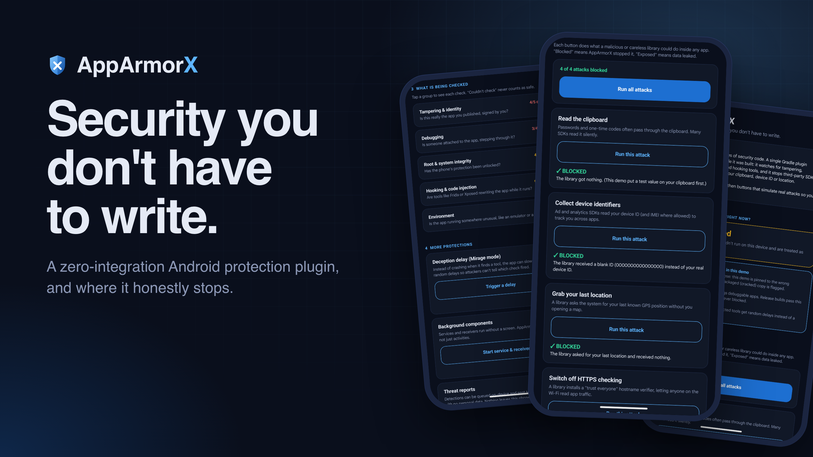
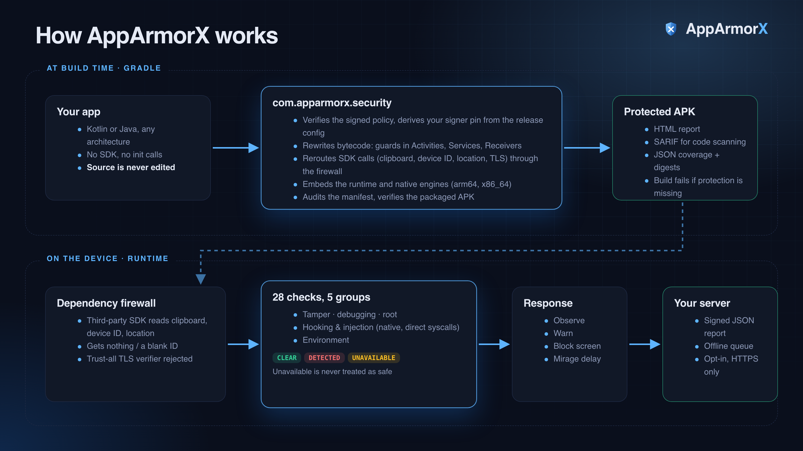
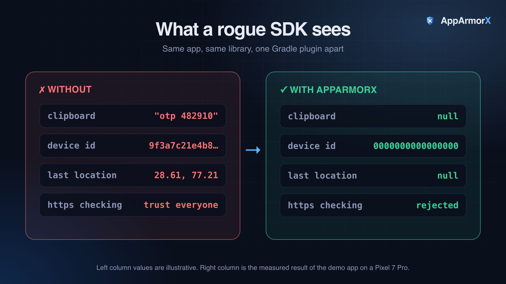
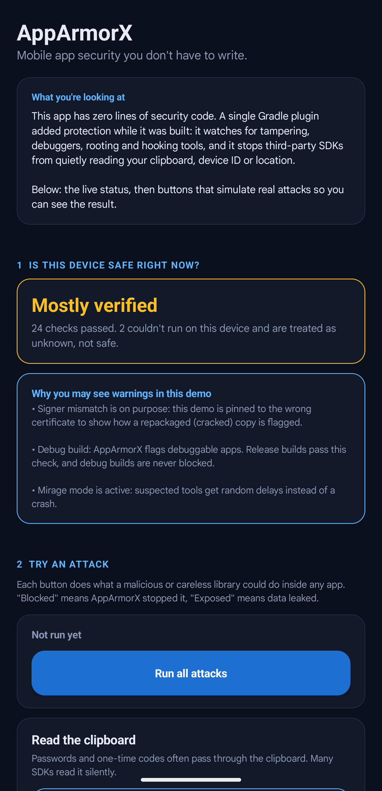
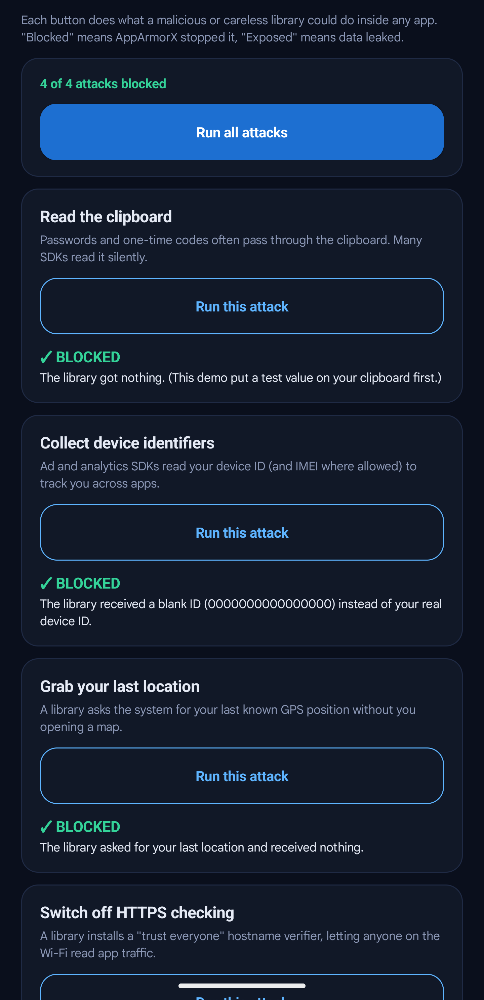
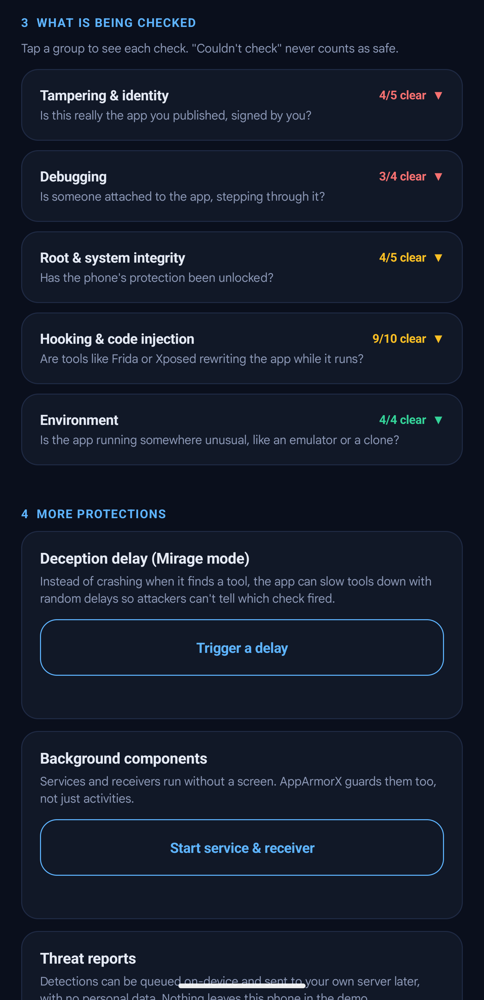

# Android app security you don't have to write — and the week I spent trying to break it with Frida

*I built a one-line Gradle plugin that hardens Android apps at build time. Then I attacked it on a rooted device with a real Frida server. Here is what held, what didn't, and what nothing client-side can ever fix.*

> DRAFT, NOT POSTED. Images referenced below live in `docs/brand/out/` and `docs/brand/shots/`; upload them to Medium manually when publishing. Nothing here has been published without owner authorization.



---

## TL;DR

- **AppArmorX** is a free Gradle plugin. You add one line to `build.gradle.kts`. You write **zero** security code.
- At build time it rewrites your bytecode, bundles a native detection engine, guards every Activity / Service / Receiver, and reroutes sensitive API calls, even those made inside third-party SDKs.
- I didn't trust my own green test suite, so I attacked it on a rooted emulator with real Frida. Results: the dependency firewall blocked **4/4** attacks; root and repackaging detection worked against real attacks; and I found a **real gap** (direct framework calls from injected code).
- An opt-in `killOnConfirmedHooking` + watchdog **prevented** the live MITM when Frida attached to a running app. It **cannot** stop spawn-time injection (`frida -f`), and I say so plainly.
- Nothing here is "unbypassable." Every claim has a device, an attack and a log behind it.

---

## 1. The integration tax

Most Android protection ships as an SDK. You add a dependency, write init code, register callbacks, and design your own "this device looks compromised" screen. Teams skip it because it's work, or wire up half of it and call it done.

Meanwhile the libraries already inside your app (analytics, ads, attribution) can quietly read:

- the **clipboard** (OTPs and passwords pass through it),
- the **device ID / IMEI**,
- the **last known location**,
- and some install **trust-all TLS verifiers** that let anyone on the Wi-Fi read traffic.

None of that requires *you* to write a line that asked for it.

I wanted the integration tax to be not "lower" but **gone**.

## 2. The idea: let the build do it

AppArmorX is a Gradle plugin. This is the entire integration:

```kotlin
plugins {
    id("com.android.application")
    id("com.apparmorx.security") version "0.1.0"
}
```

No init call. No listener. No custom block screen. Your source tree is never edited. I verified that by decompiling the bytecode AGP shipped into a sample APK and diffing it against the pre-instrumentation class.



### What happens at build time

1. **Policy verification.** A signed policy (Ed25519, with a rollback floor) is verified before anything else.
2. **ASM bytecode rewrite** using AGP's instrumentation API:
   - security guards are woven into every `Activity`, `Application`, `Service` and `BroadcastReceiver`;
   - calls to clipboard, device-ID, location and TLS APIs are **rerouted through a policy layer**.
3. **Native engine bundled** for `arm64-v8a` and `x86_64`.
4. **Manifest audit + SARIF report.** Release `debuggable`, `allowBackup`, cleartext traffic and similar are flagged; results export as SARIF 2.1.0 for GitHub Code Scanning or SonarQube.
5. **Build fails if protection is missing.** A coverage verifier checks the packaged APK and breaks `assembleRelease` if required artifacts are absent.

It is also fully **Configuration Cache** compatible.

### What happens at run time

- A **startup gate** runs before the first screen, checking debugger, debuggable flag, signer and tracer. An optional fail-closed mode holds sensitive execution until the first verdict exists.
- **28 checks** across JVM, framework and native C++: root, debugger/tracer attach, Frida/Xposed/Substrate artifacts, injected threads, anonymous executable memory, libc hook trampolines, W^X, SELinux state, emulator signals, APK integrity.
- The sensitive `/proc` reads use **direct syscalls** (`svc #0` on ARM64, `syscall` on x86_64), so a hooked libc can't trivially lie to them.
- **Services and receivers** are guarded, not just Activities, and multi-process apps share one security state.

## 3. The dependency firewall (zero-trust for SDKs)

This is the part I'm most excited about. Because the rewrite happens on the compiled bytecode, it covers **library code you didn't write**.

| Intercepted call | Effect |
|---|---|
| `ClipboardManager.getPrimaryClip` / `hasPrimaryClip` | returns nothing |
| `Settings.Secure` ANDROID_ID, `getDeviceId`, `getImei` | sanitised value |
| `LocationManager.getLastKnownLocation` | returns nothing |
| `HttpsURLConnection` hostname verifier, `SSLContext.init` | permissive/trust-all managers rejected |



*The left column is illustrative; the right column is the measured result of the demo app on a Pixel 7 Pro.*

## 4. Three design decisions that mattered more than any feature

**Unknown is never "clean."** Every check returns `CLEAR`, `DETECTED` or `UNAVAILABLE`. If a probe can't run (an OEM blocks a `/proc` read, a native lib fails to load) the app reports "couldn't check", never "passed". It's easy, under deadline, to let a failed read fall through to `false` and call it clean. I found three places in my own code where exactly that had happened (more in section 7).

**Don't enforce on things the attacker doesn't control.** Early on, "this app permits cleartext HTTP" counted as a threat. That would lock out real users of an app that deliberately allows HTTP somewhere, while catching zero attackers. It's now an advisory finding: reported, never enforced. Enforcement is reserved for device/tamper/instrumentation evidence.

**Defaults that protect, with every override visible.** A plugin that only observes protects no one; one that blocks by default can brick your own debug build. So there are three profiles, and debuggable builds never enforce against their own developer:

| Profile | Response to a *confirmed* threat | Firewall | Startup gate | Screen-capture block |
|---|---|---|---|---|
| `DEVELOPMENT` | observe only | off | off | off |
| **`STANDARD`** (default) | block screen | on | off | off |
| `HARDENED` | block screen | on | fail-closed | on |

```kotlin
security {
    profile.set("HARDENED")   // DEVELOPMENT | STANDARD | HARDENED
}
```

Any explicit override weaker than the profile is flagged as **WEAKENED** in the generated HTML report, so nobody can quietly dial protection down.

## 5. Zero config, taken literally

Release builds need a pinned signing certificate so a re-signed (cracked) copy gets flagged. Asking developers to paste a SHA-256 fingerprint by hand is exactly the tax I was trying to remove, so the plugin reads the release `signingConfig` keystore at build time and derives the pin itself. I checked the result against `keytool`'s output, byte for byte. The keystore password is used only during the build and never lands in the APK or reports.

## 6. Seeing it work: the demo app

The `sample` app has zero lines of security code and ships a live "SOC" HUD with an attack simulator.



Note the honest status: **"Mostly verified. 24 checks passed. 2 couldn't run on this device and are treated as unknown, not safe."** That sentence is the three-state model in action. The demo is also deliberately pinned to the wrong signer certificate, to show how a repackaged copy is flagged.

Each button does what a malicious or careless library could do inside any app:



Clipboard read: nothing. Device ID: a blank `0000000000000000`. Last location: nothing. Trust-everyone HTTPS verifier: rejected. **4 of 4 blocked.**

And every one of the 28 checks is visible, grouped, with "couldn't check" never counted as safe:



## 7. Then I stopped trusting my test suite and attacked it

Here's the part most write-ups skip. I had green tests, a demo and decent docs, and none of that proved the thing stops anything *real*. So I set up a **rooted Android emulator**, pushed a real `frida-server`, wrote a **self-signed-cert attacker HTTPS server**, and tried to break my own plugin. The clean-room consumer app was built only from the plugin's embedded runtime.

### What held up

- The **dependency firewall blocked 4/4 attacks**, live, on-device.
- **Root detection** flagged a real `su` binary.
- **Repackaging**: I built a release with a real keystore (confirmed CLEAR), unzipped it, tampered with it, re-signed with an unrelated keystore, and reinstalled. Detection flipped **CLEAR → DETECTED** on the live app.

### What didn't

I attached Frida and, instead of going through the app's rewritten call sites, called Android's TLS APIs **directly from injected code**: `SSLContext.init()` with a permissive trust manager. That call never touches my rewritten bytecode, so there's nothing to intercept. **Full MITM succeeded**, even against a build that had already detected root and moved to a restricted state.

Detection is not prevention once an attacker is executing code inside your process. I don't believe any client-side library can fully close that door. If a vendor says theirs does, ask to see the Frida session, not the slide deck.

### A bug I only found because I kept pushing

While investigating, I discovered three of my own native checks (the ones reading `/proc/net/tcp` and `/sys/fs/selinux/enforce`) silently returned **"clean" whenever the read itself failed**. On a real SELinux-enforcing device, an app's sandboxed process is denied that read, so those checks were false negatives *by construction*, on exactly the hardened devices where it mattered. One was even locked in by a wrong assertion in my own unit tests. All three now follow the rule the rest of the codebase already had: **a failed read means UNAVAILABLE, never clean.**

## 8. The fix that worked, and the honest line around it

I added one narrowly scoped, explicitly opt-in response:

```kotlin
security {
    killOnConfirmedHooking.set(true)   // off by default in EVERY profile
}
```

- It fires **only** on confirmed hooking/injection evidence. Never on root, never on a signer mismatch, never on `UNAVAILABLE`.
- It's forced off on debuggable builds.
- Paired with `HookWatchdog`, a dedicated poll loop (~750 ms) independent of any Activity, it re-checks continuously.

Two runs of the same attack, same build, minutes apart:

| Scenario | Result |
|---|---|
| **Attach mode**: Frida attaches to an already-running app (the realistic pattern against an installed app) | **Attack prevented.** The script printed its first line, then: *"Failed to load script: the connection is closed."* The process was gone before the permissive trust manager was installed. Confirmed via `logcat` and `adb shell pidof` going from a live PID to nothing in about a second. |
| **Spawn mode**: `frida -f` launches the app itself | **Attack still succeeded.** The attacker's code runs before this library's first instruction. Nothing inside the process can win that race. |

One scenario genuinely closed, one architecturally impossible. Both belong in the same sentence, which is why they're here together.

I also tried a native anti-ptrace trick (`antiPtraceHardening`). On a modern SELinux-enforcing device it made no practical difference, because the OS already denies that domain ptrace on itself. It stays as an off-by-default, safe-to-fail opt-in, and I'm not marketing it as closing any gap.

### "But companies pay a lot for commercial RASP..."

As far as I can tell, they don't close the spawn-mode gap either. They obfuscate their own detection heavily enough to make it expensive to find and patch, which raises attacker cost but isn't prevention. The architecturally different answer is moving the trust decision to **hardware-backed, server-verified attestation** (Play Integrity) that lives outside the vulnerable process. That's on my roadmap, written down, **not implemented**.

## 9. DevSecOps output

- **HTML report** per variant: verdict, active layers, overrides, digests. Self-contained and script-free, so you can attach it to a release or hand it to an auditor.
- **SARIF 2.1.0** with stable rule IDs (`AAX-101` to `AAX-206`).
- **Optional telemetry** to *your own* server: HMAC-SHA256-signed JSON, offline queue, backoff, no redirects. Off unless you set a URL; no user data or device identifiers.

## 10. Honest limits

- Nothing is unbypassable. A determined attacker with kernel or hypervisor control can patch any client-side protection. This raises attacker cost and gives you evidence.
- Client-side checks complement server-side authorisation; they never replace it.
- Tested mainly on one physical device family (Pixel 7 Pro, Android 17) plus emulators. **No independent penetration test has been done.**
- Full GOT relocation validation isn't complete; payload integrity is presence-checked plus optional digest pins.
- Flutter / React Native / Unity hosts are untested, and protecting the Android shell doesn't protect Dart or JS business logic.
- Emulator detection is best-effort; the native emulator probe is weaker than the Kotlin one.

## 11. Try it

AppArmorX is free, inspectable, Apache-2.0, and **pre-release (0.1.0)**. It is published on the Gradle Plugin Portal; see `QUICKSTART.md` for setup. The full validation log, with every attack, timestamp and fix, is in `docs/VALIDATION.md` and `docs/STATUS.md`.

If you work on Android security and want to try to break it, I'd genuinely like to hear how.

*— Shushant Tiwari*
